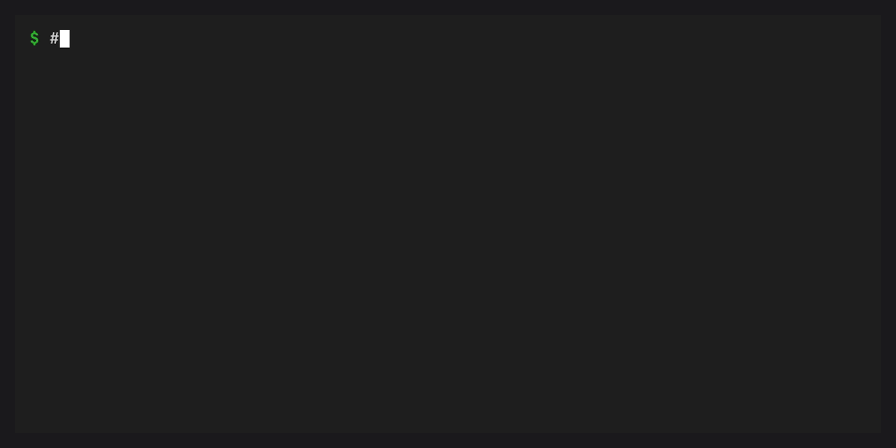

# Manage features and scopes

Inspect the feature at the scope you want to change:

```sh
conda feature list --user
conda feature explain FEATURE --user
conda feature enable FEATURE --user --dry-run
```

Replace `FEATURE` with an ID returned by `list`. Feature IDs identify capabilities, not necessarily package names. The provider decides which scopes it supports.

## Choose the destination

| Selection | Configuration destination | What it does not select |
| --- | --- | --- |
| `--user` or no scope flag | Conda's user configuration destination | Every user's configuration |
| `--system` | `.condarc` in the conda root installation | A machine-wide service or privileged installation mode |
| `--prefix PATH` | `.condarc` in an existing conda environment | Where deployment prerequisite packages are installed |
| `--file PATH` | A standalone user-scope configuration file | An isolated home, shell profile, or conda runtime |

The scope flags are mutually exclusive. An explicit file must be named `.condarc`, `condarc`, or have a YAML extension, and its parent directory must exist. `--prefix` requires an environment with a `conda-meta` directory. This command does not create environments.

For normal scopes, conda determines configuration precedence. Another file or an environment variable can override a saved value. `--file` reads the selected file plus environment-variable overrides. Ordinary conda invocations will not automatically read that file later.

## Enable and configure

This recording uses an isolated configuration and the completion provider's declared shell setting. It changes only that setting, not shell startup files.



```sh
conda feature enable FEATURE --prefix /path/to/environment --dry-run
conda feature enable FEATURE --prefix /path/to/environment --yes
conda feature config FEATURE --set plugins.example_limit 4 \
  --prefix /path/to/environment --dry-run
```

The example setting name is a placeholder. Use `explain` to find the provider's configurable settings. Use `--set KEY VALUE` for each setting, repeating `--set` to change several together. Conda validates the values' types. You can change only declared non-secret scalar settings this way.

Version 0.2.0 uses `config --set`. On release 0.1.0, use `configure FEATURE KEY=VALUE` instead. That syntax remains supported for existing scripts.

To inspect a setting before changing it:

```sh
conda feature config FEATURE --get --user
conda feature config FEATURE --show --user
conda feature config FEATURE --show-sources --user
conda feature config FEATURE --describe --user
conda feature config FEATURE --validate --user
```

`--get` reads saved values. `--show` reads the effective values after defaults and overrides. Pass setting names after either option to limit the result. `--show-sources` includes only the feature's declared settings, not unrelated configuration values.

Remove a saved override to return to inherited configuration or a default:

```sh
conda feature config FEATURE --remove-key plugins.example_limit --user --dry-run
conda feature config FEATURE --remove-key plugins.example_limit --user --yes
```

This does not force a particular effective value. Check `--show` afterward. The planner rejects a removal that would leave an enabled feature without a required setting.

Configure a step-backed deployment before enabling it. Once it has a receipt, you must disable it before changing its configuration. The receipt identifies the resources it owns, such as the shell profile used for completion, so those settings must stay consistent until cleanup finishes.

## Include prerequisites explicitly

```sh
conda feature enable FEATURE --with-dependencies --user --dry-run
```

The preview lists prerequisite opt-ins at the selected scope. It will not change other scopes implicitly. Already-enabled prerequisites can be inherited from user or installation configuration. The command rejects cycles and unsupported write scopes.

Combined prerequisite plans support built-in scalar settings and channels. Deploy missing package or custom shell prerequisites individually first, then retry. Planning a package installation does not make those prerequisites ready.

## Protect other environments

```sh
conda feature disable FEATURE --user \
  --check-prefix /path/to/team-env \
  --check-prefix /path/to/another-env --dry-run
```

Before making shared user or installation changes, the command inspects the current user's registered conda environments and the hosting installation. Use `--check-prefix` to check another environment without writing to it. The preview lists checked environments. An enabled dependent in any of them can block disabling a shared prerequisite or introducing a conflict.

The scan skips unregistered and inaccessible environments and other users' registries. Explicit files do not trigger registry scanning. Before applying changes, the command rechecks which sources are present and their fingerprints in case another process changed them. If the plan is stale, preview again.

## Disable

```sh
conda feature disable FEATURE --user --dry-run
conda feature disable FEATURE --user --yes
conda feature disable --all --user --dry-run
```

Disabling a boolean feature saves false. Disabling a step-backed feature undoes changes it owns in reverse step order. Prerequisite packages and pre-existing resources remain in place.

`disable --all` handles boolean-backed features only and lists deployments that need individual disable commands. It cannot disable every conda plugin. Unconditional graduated features cannot be disabled here either. Use [graduation cleanup](transfer.md) to remove their obsolete opt-ins.
